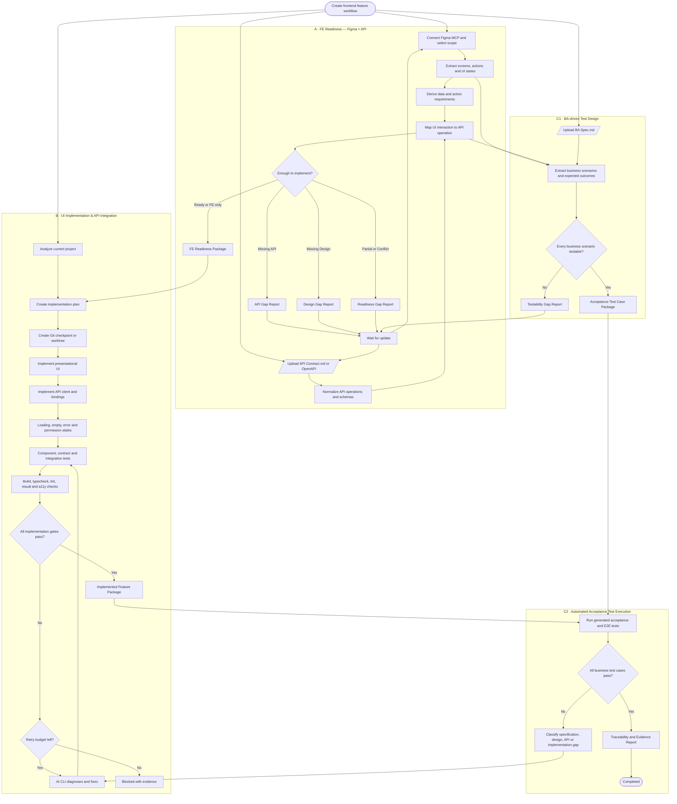
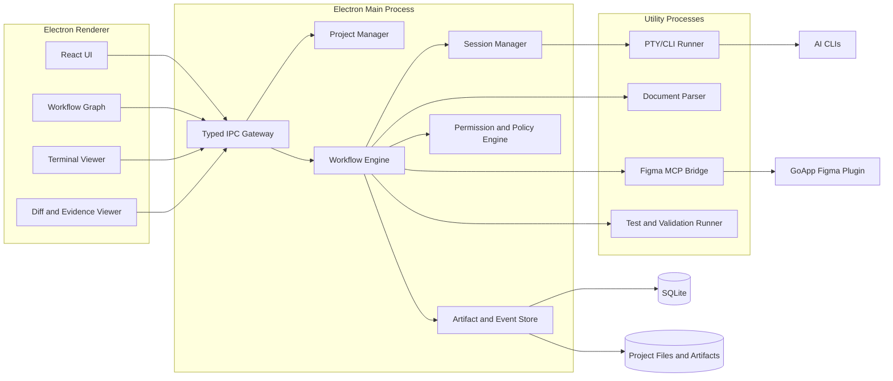

# GoApp FrontFlow

> Desktop control plane for AI-assisted frontend delivery

| Thuộc tính | Giá trị |
|---|---|
| Project name | **GoApp FrontFlow** |
| Repository slug | `goapp-frontflow` |
| Tài liệu | Product & Technical Implementation Specification |
| Phiên bản | 0.3 |
| Trạng thái | Draft for implementation |
| Cập nhật | 2026-10-22 |

## 1. Tóm tắt sản phẩm

GoApp FrontFlow là desktop application gắn với một source-code project trên máy người dùng và sử dụng các AI CLI như Codex CLI, Claude Code hoặc Gemini CLI làm execution engine.

Ứng dụng không thay thế AI CLI và không phải một workflow builder tổng quát như n8n. GoApp FrontFlow cung cấp:

- Workflow chuẩn hóa cho quá trình Figma × API Contract → frontend implementation, đồng thời dùng BA Specification để sinh và chạy automated acceptance tests.
- Giao diện node graph kiểu n8n để theo dõi tiến độ.
- Quản lý và khôi phục nhiều AI CLI session theo project.
- Thu thập prompt, log, file diff, test result và evidence.
- Tự động điều phối bước tiếp theo dựa trên kết quả của bước trước.
- Kiểm tra thiết kế và API Contract có đủ để triển khai trọn vẹn UI flow hay không.
- Truy vết từ UI interaction tới API, source code, test và business requirement liên quan.

### 1.1. Product statement

> GoApp FrontFlow biến quy trình triển khai frontend bằng AI CLI thành một pipeline có thể quan sát, tiếp tục, kiểm chứng và truy vết được.

### 1.2. Đối tượng sử dụng chính

- Frontend developer sử dụng AI để coding.
- Tech lead cần theo dõi chất lượng triển khai.
- BA/BE/QA cần xem gap report và implementation evidence.

## 2. Mục tiêu

### 2.1. Mục tiêu MVP

1. Mở hoặc attach một local frontend project.
2. Nhận diện stack, command và convention của project.
3. Upload API Contract dạng Markdown/OpenAPI và BA Specification dạng Markdown để sinh business test cases.
4. Kết nối GoApp Figma plugin qua MCP và chọn scope giao diện.
5. Tạo UI Flow Model từ thiết kế.
6. Kiểm tra mỗi screen/action/state trong thiết kế có đủ API data và operation để triển khai hay không.
7. Phân loại `Ready`, `Missing API`, `Missing Design`, `Partial`, `Conflict`, `FE-only` và `Ambiguous`.
8. Triển khai UI và ghép API trong cùng feature workflow.
9. Dùng BA Specification kết hợp UI Flow Model và API mapping để sinh acceptance/E2E test cases trước hoặc song song với implementation.
10. Sinh và chạy component, contract, integration và E2E tests.
11. Hiển thị workflow dưới dạng node graph có trạng thái thời gian thực.
12. Pause, resume, retry và lưu evidence của từng workflow run.

### 2.2. Ngoài phạm vi MVP

- Workflow builder kéo-thả tổng quát.
- Marketplace cho custom node.
- Cloud execution.
- Collaboration thời gian thực nhiều người.
- Tự động đăng nhập và chuyển đổi nhiều tài khoản AI CLI.
- Thay thế IDE hoặc Git client hoàn chỉnh.
- Tự động merge hoặc deploy production.

## 3. Nguyên tắc thiết kế

1. **AI CLI là execution engine:** app điều phối, không tái xây dựng coding agent.
2. **Evidence before completion:** không báo hoàn thành nếu chưa có bằng chứng kiểm chứng.
3. **Explicit uncertainty:** mọi suy luận phải được đánh dấu `assumed`, không được giả làm fact.
4. **FE readiness first:** Figma và API Contract là hai nguồn chính để quyết định feature đã đủ điều kiện triển khai hay chưa.
5. **BA as test oracle:** BA Specification là nguồn sinh business acceptance/E2E test cases, không phải trục audit trực tiếp BA ↔ API.
6. **Versioned inputs:** mỗi workflow run gắn với snapshot BA, API, Figma và Git commit cụ thể.
7. **Recoverable execution:** mọi thay đổi code phải có checkpoint và khả năng rollback.
8. **Structured events:** dashboard không phụ thuộc hoàn toàn vào việc parse text terminal.
9. **Project convention first:** code sinh ra phải sử dụng pattern và component của project hiện tại.
10. **Human control remains available:** người dùng có thể pause, cancel, retry hoặc can thiệp tại bất kỳ node nào.

## 4. Phạm vi workflow

GoApp FrontFlow sử dụng ba workflow nghiệp vụ chính.

### Workflow A — FE Readiness: Figma × API Contract

Trích xuất UI flow từ Figma, xác định nhu cầu dữ liệu/action/state của từng interaction và map với API Contract. Kết quả cho biết FE đã đủ điều kiện triển khai hay còn thiếu thiết kế/API.

### Workflow B — UI Implementation & API Integration

Triển khai presentational UI, ghép API, xử lý loading/empty/error/permission và chạy automated tests dựa trên FE Readiness Package.

### Workflow C — BA-driven Test Design & Auto-test

Kết hợp BA Specification với UI Flow Model và API mapping để sinh test cases độc lập với implementation, sau đó tự động chạy các test cases trên feature đã tích hợp.

### 4.1. Vai trò của nguồn dữ liệu

| Nguồn | Vai trò trong FE workflow | Có quyết định FE Readiness? |
|---|---|---|
| Figma | Mô tả screen, interaction, UI state, responsive và visual contract | Có |
| API Contract | Mô tả data, operation, response, error, auth và permission contract | Có |
| Current Project | Mô tả component, convention, routing, API client và test setup | Có, ở mức implementation feasibility |
| BA Specification | Sinh business acceptance scenarios, test data và E2E expectations | Không trực tiếp |

Không thực hiện BA ↔ API audit độc lập như một gate chính. Nếu BA requirement liên quan FE, nó được truy vết gián tiếp qua `BA requirement → UI flow → API operation`.

### 4.2. Nguồn sinh test

| Nguồn | Loại test chính | Nội dung kiểm chứng |
|---|---|---|
| Figma | Visual và component tests | Layout, state, interaction, responsive và accessibility |
| API Contract | Consumer contract và integration tests | Request, response, error, auth và field mapping |
| BA Specification | Acceptance và E2E tests | Business journey, precondition, rule và expected outcome |
| Current Project | Unit/regression conventions | Test framework, fixture, mock và command hiện có |

## 5. Workflow tổng thể



## 6. Definition of statuses

### 6.1. Workflow run status

```ts
type WorkflowRunStatus =
  | "queued"
  | "running"
  | "waiting"
  | "test_design_pending"
  | "paused"
  | "completed"
  | "completed_with_assumptions"
  | "blocked"
  | "failed"
  | "cancelled"
  | "timed_out";
```

### 6.2. Node run status

```ts
type NodeRunStatus =
  | "pending"
  | "ready"
  | "running"
  | "waiting_for_dependency"
  | "waiting_for_input"
  | "retrying"
  | "passed"
  | "failed"
  | "blocked"
  | "skipped"
  | "cancelled";
```

### 6.3. FE readiness status

| Status | Ý nghĩa |
|---|---|
| `ready` | Thiết kế và API cung cấp đủ dữ liệu, action và state để triển khai |
| `partial` | Có API/design mapping nhưng thiếu field, error hoặc state |
| `missing_api` | UI có action/data need nhưng không có API phù hợp |
| `missing_design` | API có outcome/error quan trọng nhưng Figma không có UI state |
| `conflict` | Thiết kế và API mô tả hành vi không tương thích |
| `ambiguous` | Không đủ dữ liệu để xác định mapping |
| `fe_only` | Interaction được xử lý hoàn toàn tại FE |
| `assumed` | AI phải đưa ra giả định để tiếp tục |

## 7. Kiến trúc hệ thống



## 8. Stack đề xuất

| Layer | Công nghệ đề xuất | Lý do |
|---|---|---|
| Desktop shell | Electron | Node.js integration phù hợp với filesystem, Git và AI CLI; hỗ trợ Windows/macOS/Linux |
| UI | React + TypeScript | Phù hợp năng lực FE và hệ sinh thái node graph |
| Workflow graph | React Flow | Chuyên cho node-based UI và interactive diagram |
| State UI | Zustand hoặc Redux Toolkit | Quản lý UI state; persistent business state vẫn ở database |
| Local database | SQLite | Một file local, transaction tốt, phù hợp desktop application |
| ORM/query | Drizzle ORM | Typed schema/migration; có thể thay bằng query layer khác |
| Terminal view | xterm.js | Render terminal output trong renderer |
| PTY | node-pty | Chạy CLI tương tác trên Windows/macOS/Linux |
| Git | Git CLI adapter | Tránh tái hiện đầy đủ Git implementation |
| Validation | Project-native commands | Tôn trọng toolchain hiện tại của project |
| Telemetry | OpenTelemetry-compatible event model | Correlate workflow, node, command và log |
| Unit test | Vitest | Test TypeScript domain/workflow engine |
| Desktop E2E | Playwright | Test Electron UI và workflow cơ bản |

Electron hỗ trợ tách workload sang `utilityProcess`; CLI runner, MCP bridge và parser không nên chạy trong renderer hoặc chặn main process. React Flow phù hợp với node-based interfaces. `node-pty` cung cấp PTY đa nền tảng nhưng process được chạy với quyền của app cha, vì vậy mọi execution phải đi qua policy engine.

### 8.1. Repository layout đề xuất

```text
goapp-frontflow/
├── apps/
│   └── desktop/
│       ├── src/main/
│       ├── src/preload/
│       └── src/renderer/
├── packages/
│   ├── domain/
│   ├── workflow-engine/
│   ├── project-analyzer/
│   ├── cli-adapters/
│   ├── figma-mcp-bridge/
│   ├── document-parser/
│   ├── event-schema/
│   ├── persistence/
│   └── ui-components/
├── workflows/
│   ├── fe-readiness.yaml
│   ├── ui-implementation.yaml
│   └── business-validation.yaml
├── tests/
│   ├── fixtures/
│   ├── integration/
│   └── e2e/
└── docs/
```

## 9. Electron security boundary

### 9.1. Renderer

- Không bật trực tiếp Node integration.
- Bật context isolation.
- Chỉ giao tiếp qua typed preload API.
- Không nhận raw filesystem path hoặc shell command không được kiểm tra.
- Sanitize Markdown trước khi render.

### 9.2. Main process

- Quản lý window, IPC, project permission và lifecycle.
- Không chạy tác vụ CPU-intensive hoặc PTY trực tiếp.
- Xác thực tất cả payload từ renderer.

### 9.3. Utility processes

- Một process riêng cho PTY/CLI execution.
- Một process riêng cho local MCP bridge khi cần.
- Có timeout, cancellation và crash recovery.
- Không chia sẻ secret qua command-line arguments.

## 10. Project onboarding

### 10.1. Luồng

```text
Choose project folder
  → Validate access
  → Detect Git repository
  → Analyze stack
  → Detect project commands
  → Detect installed AI CLIs
  → Create Project Profile
  → Restore prior sessions/runs
```

### 10.2. Project Profile

```yaml
schemaVersion: 1
projectId: ecommerce-web
rootPath: D:/projects/ecommerce-web
framework: nextjs
language: typescript
packageManager: pnpm
uiLibrary: antd
apiClient: tanstack-query
stateManagement: zustand
commands:
  install: pnpm install
  dev: pnpm dev
  build: pnpm build
  typecheck: pnpm typecheck
  lint: pnpm lint
  unitTest: pnpm test
  e2e: pnpm test:e2e
qualityGates:
  build: required
  typecheck: required
  lint: required
  unitTest: required
  contractTest: required
  e2e: required
  accessibility: WCAG-2.2-AA
git:
  executionMode: worktree
  defaultBaseBranch: main
```

### 10.3. Detection rules

- Đọc `package.json`, lockfile và framework config.
- Phát hiện `AGENTS.md`, `CLAUDE.md`, README và contribution guide.
- Tìm test config, route structure, API client và design tokens.
- Profile tự động phải được lưu kèm confidence và evidence.
- Người dùng có thể override mọi giá trị được phát hiện.

## 11. Input sources

### 11.1. BA Specification Markdown — automated test source

BA Specification không phải nguồn chính của FE Readiness. Nó được parse thành business scenarios, preconditions, test data, actions và expected outcomes. Workflow C kết hợp các scenarios này với UI Flow Model và API mapping để tạo automated acceptance/E2E test cases. Nếu BA chưa sẵn sàng, implementation có thể tiếp tục nhưng workflow mang trạng thái `test_design_pending` và chưa được báo business-verified.

Khuyến nghị template:

```markdown
# Feature: Cancel order

## Actors
- Customer
- Support agent

## Requirements

### BA-ORDER-001 — Customer cancels a pending order
- Actor: Customer
- Preconditions: Order status is PENDING
- Action: Confirm cancellation
- Result: Order status becomes CANCELLED
- Errors:
  - ORDER_NOT_FOUND
  - ORDER_CANNOT_BE_CANCELLED

## Acceptance criteria
- Given ... When ... Then ...
```

Parser vẫn phải hỗ trợ Markdown tự do, nhưng requirement có ID rõ ràng sẽ cho kết quả ổn định hơn.

### 11.2. API Contract Markdown — required readiness source

Khuyến nghị template:

````markdown
# Order API Contract

## POST /orders/{orderId}/cancel

- Operation ID: cancelOrder
- Authentication: Bearer token
- Allowed roles: CUSTOMER, SUPPORT

### Path parameters
- orderId: string, required

### Response 200
```json
{
  "id": "string",
  "status": "CANCELLED"
}
```

### Errors
- 404 ORDER_NOT_FOUND
- 409 ORDER_CANNOT_BE_CANCELLED
````

Ưu tiên cho phép nhúng hoặc tham chiếu OpenAPI JSON/YAML. Markdown được dùng cho giải thích nghiệp vụ, OpenAPI được dùng làm machine-readable contract.

### 11.3. Figma — live readiness source

Figma được kết nối qua GoApp Figma MCP, không upload như tài liệu tĩnh. Người dùng chọn page/frame/component thuộc feature scope. App lưu manifest và snapshot của selection cho từng workflow run.

Figma là nguồn mô tả:

- Screen và component.
- User action và navigation transition.
- Default/loading/empty/error/disabled states có trong thiết kế.
- Responsive variants.
- Design token, asset và prototype interaction.

### 11.4. Input snapshot

Mỗi workflow run phải lưu:

```ts
interface SourceSnapshot {
  id: string;
  type: "ba_markdown" | "api_markdown" | "openapi" | "figma";
  sourceUri?: string;
  contentHash: string;
  createdAt: string;
  metadata: Record<string, unknown>;
}
```

## 12. Workflow A — FE Readiness: Figma × API Contract

### 12.1. Node contracts

#### A1. SnapshotReadinessSources

**Input:** selected Figma scope và API Markdown/OpenAPI. BA snapshot có thể được đính kèm nhưng không quyết định API readiness trực tiếp.

**Output:** immutable `SourceSnapshot[]`.

**Failure conditions:** unreadable API file, empty content, unsupported encoding, Figma bridge offline hoặc selection không hợp lệ.

#### A2. ExtractUiFlow

**Output:**

```ts
interface UiFlowNode {
  id: string;
  name: string;
  kind: "screen" | "dialog" | "component" | "interaction";
  figmaNodeIds: string[];
  actions: UiAction[];
  states: UiState[];
  transitions: UiTransition[];
  sourceRefs: SourceReference[];
  confidence: number;
}
```

#### A3. ExtractApiOperations

**Output:**

```ts
interface ApiOperation {
  id: string;
  method: string;
  path: string;
  auth?: string;
  roles: string[];
  requestSchema?: JsonSchema;
  responses: ApiResponse[];
  sourceRefs: SourceReference[];
}
```

#### A4. DeriveUiDataRequirements

Với từng screen/action/state, trích xuất:

- Dữ liệu cần hiển thị.
- Query/filter/pagination cần dùng.
- Mutation hoặc command cần gọi.
- Loading, empty và success outcome.
- Technical/domain error cần biểu diễn.
- Permission hoặc role ảnh hưởng visibility/interactivity.
- Field validation và data constraints.

```ts
interface UiDataRequirement {
  id: string;
  uiFlowNodeId: string;
  kind: "query" | "mutation" | "validation" | "state" | "permission";
  description: string;
  requiredFields: string[];
  expectedOutcomes: string[];
  sourceRefs: SourceReference[];
}
```

#### A5. MapUiInteractionsToApi

Tạo mapping giữa `UiDataRequirement` và `ApiOperation`. Một interaction có thể dùng nhiều operation; một operation cũng có thể phục vụ nhiều interaction.

```ts
interface UiApiMapping {
  id: string;
  uiDataRequirementId: string;
  apiOperationIds: string[];
  fieldMappings: Record<string, string>;
  coveredOutcomes: string[];
  uncoveredOutcomes: string[];
  status:
    | "ready"
    | "partial"
    | "missing_api"
    | "missing_design"
    | "conflict"
    | "ambiguous"
    | "fe_only"
    | "assumed";
  confidence: number;
}
```

#### A6. ClassifyFeReadiness

Sinh `ready`, `partial`, `missing_api`, `missing_design`, `conflict`, `ambiguous`, `fe_only` hoặc `assumed`.

#### A7. BuildReadinessGapReport

Tách issue theo owner phù hợp:

- `API Gap`: thiếu endpoint, field, error hoặc permission contract.
- `Design Gap`: thiếu screen/state/interaction để biểu diễn outcome của API.
- `Mapping Gap`: có cả hai nguồn nhưng không xác định được quan hệ.
- `Conflict`: action/state trong Figma không tương thích với API.

#### A8. BuildUiApiTraceability

```ts
interface UiApiTraceabilityItem {
  uiFlowNodeId: string;
  figmaNodeIds: string[];
  uiDataRequirementIds: string[];
  apiOperationIds: string[];
  sourceFiles: string[];
  testIds: string[];
  evidenceIds: string[];
  status: "unverified" | "verified" | "assumed" | "blocked";
}
```

### 12.2. FE Readiness Package

```ts
interface FeReadinessPackage {
  version: 1;
  runId: string;
  sourceSnapshots: string[];
  uiFlow: UiFlowNode[];
  uiDataRequirements: UiDataRequirement[];
  operations: ApiOperation[];
  mappings: UiApiMapping[];
  traceability: UiApiTraceabilityItem[];
  summary: {
    ready: number;
    partial: number;
    missingApi: number;
    missingDesign: number;
    conflict: number;
    ambiguous: number;
    feOnly: number;
  };
  readiness: "ready" | "ready_with_assumptions" | "not_ready";
}
```

### 12.3. Completion policy

- `ready`: mọi UI data/action requirement bắt buộc đã được map hoặc xác định là `fe_only`.
- `ready_with_assumptions`: chỉ còn assumption được policy cho phép.
- `not_ready`: còn `missing_api`, `missing_design`, `conflict` hoặc `ambiguous` blocking.

## 13. Workflow B — UI Implementation & API Integration

### 13.1. Figma MCP architecture

```text
GoApp Figma Plugin
  ↕ WebSocket/HTTP with pairing token
GoApp FrontFlow Local Figma Bridge
  ↕ MCP tools/resources
AI CLI adapter
```

Desktop app sở hữu local bridge để:

- Theo dõi connection status.
- Bind Figma session với project/workflow.
- Log MCP calls.
- Cache và snapshot response.
- Giới hạn quyền theo selected file/page/node.
- Cho phép nhiều AI CLI dùng cùng integration mà plugin không cần biết từng CLI.

### 13.2. MCP tools tối thiểu

```text
get_connection_status
get_current_selection
get_node_summary
get_node_tree
get_component_properties
get_design_tokens
get_prototype_interactions
render_node
export_assets
get_warnings
```

Tool phải khai báo đặc tính như read-only, idempotent hoặc destructive, nhưng policy engine vẫn là nơi cưỡng chế quyền.

### 13.3. Context strategy

Không gửi toàn bộ Figma document vào prompt. Ban đầu chỉ cung cấp manifest:

```json
{
  "fileKey": "...",
  "pageId": "...",
  "selectedNodes": [
    {
      "nodeId": "123:456",
      "name": "Create Tournament Modal",
      "type": "FRAME",
      "states": ["default", "validation-error", "loading"]
    }
  ],
  "availableTools": [
    "get_node_tree",
    "get_design_tokens",
    "render_node",
    "export_assets"
  ]
}
```

AI gọi MCP theo nhu cầu để giảm context size.

### 13.4. Visual validation

- Render implementation tại viewport tương ứng.
- So sánh screenshot với Figma render.
- Kiểm tra layout, spacing, typography, color và assets.
- Kiểm tra responsive variants.
- Chạy accessibility checks theo project profile.
- Lưu screenshot/diff làm evidence.

### 13.5. Implementation sequence

1. Nhận `FeReadinessPackage` đã đạt policy.
2. Phân tích component, design token, API client và test convention trong project.
3. Tạo Git checkpoint hoặc worktree.
4. Triển khai presentational UI từ Figma.
5. Sinh hoặc sử dụng API client hiện có.
6. Bind query/mutation vào interaction tương ứng.
7. Triển khai loading, empty, error, disabled và permission states.
8. Sinh component, consumer contract và integration tests.
9. Chạy build, typecheck, lint, visual và accessibility gates.

### 13.6. Runtime verification

- `Consumer verified`: FE API client gửi/nhận đúng contract.
- `Provider verified`: backend runtime đáp ứng contract.
- Nếu backend runtime không khả dụng, feature phải mang trạng thái `contract_only`, không được báo `runtime_verified`.

## 14. Workflow C — BA-driven Test Design & Auto-test

BA Specification là business test oracle, không phải trục mapping chính giữa Figma và API. Test case phải được sinh trước hoặc song song với implementation để tránh việc AI viết test chỉ nhằm hợp thức hóa code đã tạo.

### 14.1. C1 — Generate Acceptance Test Cases

- Parse BA thành scenario có `Given / When / Then` hoặc cấu trúc tương đương.
- Map scenario với `UiFlowNode`, Figma node và `ApiOperation` liên quan.
- Sinh test steps, test data, mock/provider state và expected outcome.
- Chọn test level phù hợp: component, integration hoặc E2E.
- Phát hiện scenario chưa testable do thiếu design, API, test data hoặc expected outcome.
- Không phụ thuộc vào code implementation khi xác định expected result.

```ts
interface AcceptanceTestCase {
  id: string;
  requirementIds: string[];
  title: string;
  preconditions: TestPrecondition[];
  steps: TestStep[];
  expectedOutcomes: ExpectedOutcome[];
  testData: TestDataRequirement[];
  uiFlowNodeIds: string[];
  figmaNodeIds: string[];
  apiOperationIds: string[];
  level: "component" | "integration" | "e2e";
  automationStatus:
    | "planned"
    | "generated"
    | "executed"
    | "manual"
    | "blocked";
  sourceRefs: SourceReference[];
}
```

### 14.2. Acceptance Test Case Package

```ts
interface AcceptanceTestCasePackage {
  version: 1;
  runId: string;
  baSnapshotId: string;
  readinessPackageId: string;
  testCases: AcceptanceTestCase[];
  testabilityGaps: TestabilityGap[];
  coverage: {
    totalRequirements: number;
    requirementsWithTests: number;
    automatableRequirements: number;
    blockedRequirements: number;
  };
  status: "ready" | "ready_with_gaps" | "blocked";
}
```

### 14.3. C2 — Generate and Execute Auto-tests

- Sinh test code theo test framework hiện có trong project.
- Component tests xác nhận business state ở phạm vi component.
- Integration tests xác nhận UI ↔ API mapping và response handling.
- E2E tests chạy user journey từ BA trên application runtime.
- Thu thập screenshot, trace, network record và assertion results làm evidence.
- Khi test fail, phân loại root cause là `specification_gap`, `design_gap`, `api_gap`, `test_generation_gap` hoặc `implementation_gap`.
- Chỉ `Completed` khi test cases bắt buộc đã chạy và pass; nếu còn assumption được phép thì dùng `Completed with assumptions`.

### 14.4. Test traceability

```ts
interface TestTraceabilityItem {
  requirementId: string;
  testCaseIds: string[];
  uiFlowNodeIds: string[];
  figmaNodeIds: string[];
  apiOperationIds: string[];
  sourceFiles: string[];
  testIds: string[];
  evidenceIds: string[];
  status: "untested" | "passed" | "failed" | "assumed" | "blocked";
}
```

## 15. Verification levels and quality gates

### 15.1. Các tầng kiểm chứng

| Level | Ý nghĩa |
|---|---|
| FE ready | Figma và API Contract đủ để triển khai UI flow |
| Test designed | BA requirements đã được chuyển thành testable scenarios |
| Consumer verified | FE API client gửi/nhận đúng contract |
| Provider verified | API runtime đáp ứng contract |
| Integration verified | UI xử lý đúng response và error states |
| E2E verified | User journey hoàn chỉnh hoạt động |
| Business verified | Generated acceptance/E2E tests từ BA đã chạy và pass |

Nếu backend runtime không khả dụng, workflow chỉ được báo `contract-only`, không được báo `runtime verified`.

### 15.2. Quality gates

```yaml
gates:
  - id: build
    required: true
  - id: typecheck
    required: true
  - id: lint
    required: true
  - id: unit-test
    required: true
  - id: consumer-contract-test
    required: true
  - id: provider-verification
    required: false
    fallbackStatus: contract-only
  - id: integration-test
    required: true
  - id: ba-acceptance-test-coverage
    required: true
    target: 100%-of-blocking-requirements
  - id: e2e-test
    required: true
  - id: accessibility
    target: WCAG-2.2-AA
```

## 16. AI CLI adapter

### 16.1. Adapter interface

```ts
interface AiCliAdapter {
  readonly id: string;

  detect(): Promise<CliDetectionResult>;
  capabilities(): Promise<CliCapabilities>;
  start(input: StartSessionInput): Promise<AiSession>;
  resume(input: ResumeSessionInput): Promise<AiSession>;
  send(sessionId: string, message: string): Promise<void>;
  approve(sessionId: string, requestId: string): Promise<void>;
  reject(sessionId: string, requestId: string): Promise<void>;
  cancel(sessionId: string): Promise<void>;
  subscribe(sessionId: string, handler: AgentEventHandler): Unsubscribe;
}
```

### 16.2. Capability model

```ts
interface CliCapabilities {
  structuredEvents: boolean;
  resumableSessions: boolean;
  mcp: boolean;
  toolApprovals: boolean;
  modelSelection: boolean;
  usageReporting: boolean;
  imageInput: boolean;
}
```

App không giả định mọi CLI có cùng capability. Workflow node phải kiểm tra capability trước khi chạy.

### 16.3. Normalized agent events

```ts
type AgentEvent =
  | BaseEvent<"session.started", SessionStartedPayload>
  | BaseEvent<"status.changed", StatusChangedPayload>
  | BaseEvent<"message.delta", MessageDeltaPayload>
  | BaseEvent<"tool.started", ToolStartedPayload>
  | BaseEvent<"tool.completed", ToolCompletedPayload>
  | BaseEvent<"approval.required", ApprovalPayload>
  | BaseEvent<"file.changed", FileChangedPayload>
  | BaseEvent<"command.started", CommandStartedPayload>
  | BaseEvent<"command.completed", CommandCompletedPayload>
  | BaseEvent<"test.result", TestResultPayload>
  | BaseEvent<"usage.updated", UsagePayload>
  | BaseEvent<"session.completed", SessionCompletedPayload>
  | BaseEvent<"session.failed", SessionFailedPayload>;

interface BaseEvent<TType extends string, TPayload> {
  id: string;
  type: TType;
  timestamp: string;
  traceId: string;
  workflowRunId: string;
  nodeRunId?: string;
  sessionId?: string;
  payload: TPayload;
}
```

### 16.4. PTY fallback

Nếu CLI không cung cấp structured output:

1. Chạy trong PTY.
2. Lưu raw stream.
3. Adapter parse known markers thành normalized events.
4. Event không chắc chắn phải mang confidence.
5. Không dùng text parsing để tự động approve thao tác nguy hiểm.

## 17. Workflow engine

### 17.1. Node definition

```ts
interface WorkflowNodeDefinition<TInput, TOutput> {
  id: string;
  type: string;
  version: number;
  dependencies: string[];
  retryPolicy: RetryPolicy;
  timeoutMs: number;
  inputSchema: JsonSchema;
  outputSchema: JsonSchema;
  execute(context: NodeExecutionContext, input: TInput): Promise<TOutput>;
}
```

### 17.2. Retry policy

```ts
interface RetryPolicy {
  maxAttempts: number;
  backoff: "none" | "linear" | "exponential";
  retryableErrors: string[];
}
```

Không retry tự động các lỗi:

- Thiếu quyền truy cập.
- Tài liệu conflict.
- Command yêu cầu destructive approval.
- Test thất bại lặp lại cùng root cause quá retry budget.
- Project có thay đổi ngoài workflow làm invalid checkpoint.

### 17.3. Idempotency

- Mỗi node run có `idempotencyKey` dựa trên input hash và node version.
- Node read-only có thể dùng cached output.
- Node sửa code phải kiểm tra Git base SHA trước khi chạy lại.
- Không tái sử dụng output nếu BA/API/Figma snapshot đã đổi.

## 18. Persistence model

### 18.1. SQLite tables

```text
projects
project_profiles
source_documents
source_snapshots
workflow_definitions
workflow_runs
node_runs
ai_cli_installations
ai_sessions
agent_events
artifacts
requirements
ui_flow_nodes
ui_data_requirements
api_operations
ui_api_mappings
acceptance_test_cases
testability_gaps
ui_api_traceability_items
test_traceability_items
test_results
git_checkpoints
approvals
```

### 18.2. Artifact storage

SQLite lưu metadata; nội dung lớn lưu trên filesystem:

```text
{appData}/goapp-frontflow/
├── database.sqlite
├── projects/{projectId}/
│   ├── snapshots/
│   ├── runs/{runId}/
│   │   ├── documents/
│   │   ├── prompts/
│   │   ├── logs/
│   │   ├── diffs/
│   │   ├── screenshots/
│   │   ├── test-results/
│   │   └── evidence/
│   └── sessions/
└── logs/
```

Mỗi artifact cần `contentHash`, `mimeType`, `source`, `createdAt` và `retentionPolicy`.

## 19. Git execution safety

### 19.1. Preflight

- Ghi lại base commit SHA.
- Kiểm tra branch và working tree.
- Không ghi đè thay đổi có sẵn của người dùng.
- Khuyến nghị chạy workflow trong worktree hoặc branch riêng.
- Chụp diff trước và sau mỗi mutation node.

### 19.2. Concurrency

- Mặc định chỉ một mutation node được ghi vào cùng worktree tại một thời điểm.
- Read-only analysis nodes có thể chạy song song.
- Nếu cho phép nhiều agent code song song, mỗi agent dùng worktree riêng.
- Merge giữa worktree là một node explicit, không phải side effect ẩn.

### 19.3. Rollback

- Rollback về checkpoint của workflow, không reset toàn bộ project.
- Không dùng destructive Git operation trên working tree của người dùng.
- Hiển thị chính xác file sẽ bị ảnh hưởng trước khi rollback.

## 20. Dashboard UX

### 20.1. Main screens

1. **Projects:** danh sách project, stack, recent run và health.
2. **Project Overview:** profile, Git status, CLI integrations và workflows.
3. **New Feature Run:** kết nối Figma, upload API Contract, tùy chọn upload BA Spec và chọn scope.
4. **Workflow Canvas:** node graph và execution state.
5. **Node Inspector:** input, prompt, session, tools, output, diff và evidence.
6. **Traceability Matrix:** UI interaction ↔ Figma ↔ API operation và BA requirement ↔ generated test case ↔ test evidence.
7. **Sessions:** AI CLI sessions có thể resume.
8. **Settings:** CLI adapters, MCP, security, retention và quality gates.

### 20.2. Workflow node visual states

| State | Biểu diễn |
|---|---|
| Pending | Neutral |
| Running | Animated activity indicator |
| Passed | Success indicator |
| Waiting | Waiting indicator và dependency label |
| Retrying | Attempt counter |
| Blocked | Warning indicator và blocker summary |
| Failed | Error indicator |
| Assumed | Assumption badge |

Không chỉ dùng màu; luôn có icon và text để đảm bảo accessibility.

### 20.3. Node Inspector tabs

- Overview.
- Inputs.
- AI session.
- Terminal.
- Files changed.
- Tests.
- Evidence.
- Events.

## 21. Observability

Mỗi workflow run là một trace:

```text
workflow.run
├── node.analyze_ba
├── node.analyze_api
├── node.map_ui_to_api
├── node.generate_acceptance_tests
├── node.implement_ui
│   ├── ai.session
│   ├── tool.call
│   ├── file.write
│   └── command.test
└── node.verify
```

### 21.1. Metrics MVP

- Workflow duration.
- Node duration.
- Retry count.
- Pass/fail/blocked rate.
- AI token/cost nếu CLI cung cấp.
- Files changed.
- Test pass rate.
- Requirement coverage.
- Time waiting for external input.

### 21.2. Logging rules

- Structured JSON events.
- Redact tokens, secrets và environment variables.
- Không lưu toàn bộ request/response nhạy cảm mặc định.
- Raw PTY log có retention riêng và có thể tắt.

## 22. Security model

### 22.1. Trust boundaries

- Uploaded Markdown là untrusted input.
- Figma content là untrusted input.
- Repository files có thể chứa prompt injection.
- AI-generated command là untrusted action proposal.
- MCP tool annotations chỉ là metadata; host policy mới quyết định quyền.

### 22.2. Permission classes

```ts
type PermissionClass =
  | "read_project"
  | "write_project"
  | "run_project_command"
  | "git_mutation"
  | "network_access"
  | "read_external_design"
  | "export_asset"
  | "destructive_action";
```

### 22.3. Default policy

- Read project: allow after project selection.
- Write project: allow only inside active worktree/root.
- Run known scripts: allow according to project profile.
- Arbitrary shell command: log and evaluate policy.
- Destructive action: always require explicit approval in MVP.
- External network: deny unless integration requires it.
- Credentials: store bằng OS credential vault, không lưu plaintext trong SQLite.

### 22.4. Figma MCP pairing

- Bind local connection to one-time pairing token.
- Token có expiry và scope theo project/workflow.
- Chỉ bind localhost mặc định.
- Plugin hiển thị app/session đang kết nối.
- Người dùng có thể revoke connection.

## 23. Testing strategy cho GoApp FrontFlow

### 23.1. Unit tests

- Workflow state transitions.
- Retry/timeout/cancellation.
- UI/API readiness classification.
- Event normalization.
- Permission policy.
- Hash/version invalidation.

### 23.2. Adapter contract tests

Mọi AI CLI adapter phải chạy cùng một contract suite:

- Detect installation.
- Start session.
- Send prompt.
- Receive normalized events.
- Handle approval.
- Cancel.
- Resume nếu supported.
- Recover process exit.

### 23.3. Integration tests

- SQLite migrations and persistence.
- PTY runner với fake CLI fixture.
- Figma MCP bridge với fake plugin.
- Git worktree/checkpoint lifecycle.
- Figma selection + API upload → FE Readiness Package.
- BA Spec + FE Readiness Package → Acceptance Test Case Package.
- Generated test code → execution result → traceability evidence.

### 23.4. Desktop E2E

- Open project.
- Create workflow run.
- Upload BA/API Markdown.
- Connect fake Figma plugin.
- Run fake AI CLI.
- Generate and execute an acceptance test case.
- Inspect node output.
- Pause/resume/retry.
- Restart app và restore session/run.

## 24. Implementation roadmap

### Phase 0 — Technical spike

**Mục tiêu:** chứng minh các integration rủi ro cao.

- Electron main/renderer/utility-process skeleton.
- Chạy một fake CLI và một real AI CLI qua PTY.
- Stream output tới renderer.
- Persist/reload một session.
- Hiển thị static workflow bằng React Flow.
- Local Figma MCP bridge proof of concept.

**Exit criteria:** app có thể chạy/resume một CLI session và nhận một MCP tool result.

### Phase 1 — Project workspace

- Project picker.
- Project analyzer.
- Project Profile.
- Git preflight/checkpoint.
- SQLite schema/migrations.
- Projects dashboard.

**Exit criteria:** mở lại app vẫn khôi phục project/profile chính xác.

### Phase 2 — Workflow runtime

- Workflow/node definitions.
- Scheduler và dependency resolution.
- State machine.
- Retry, timeout, pause, resume, cancel.
- Artifact store và event stream.
- Workflow Canvas và Node Inspector.

**Exit criteria:** chạy hoàn chỉnh một sample DAG có parallel, branch, retry và restart recovery.

### Phase 3 — FE Readiness

- Production-ready Figma local bridge.
- API Markdown/OpenAPI upload và snapshot.
- UI Flow extraction.
- UI data/action requirement derivation.
- UI interaction ↔ API operation mapping.
- FE readiness classification.
- Design/API/Mapping Gap Reports.
- FE Readiness Matrix UI.

**Exit criteria:** selected Figma scope và API fixture tạo `FeReadinessPackage` deterministic, có source references và owner-specific gap reports.

### Phase 4 — UI implementation & API integration

- Pairing, connection status và Figma snapshot/artifacts.
- MCP tools và on-demand context retrieval.
- Project convention analysis.
- AI CLI implementation node.
- API client và UI binding.
- Loading, empty, error và permission states.
- Consumer contract/component/integration tests.
- Visual validation evidence.

**Exit criteria:** từ `FeReadinessPackage` có thể tạo feature đã ghép API trong sample project và lưu test/screenshot/diff evidence.

### Phase 5 — BA-driven auto-test & evidence

- BA Markdown parser.
- Business scenario và expected-outcome extraction.
- BA requirement ↔ UI flow ↔ API mapping.
- Acceptance Test Case Package.
- Test code generation theo framework của project.
- Automated component/integration/E2E execution.
- Test traceability matrix.
- Root-cause classification: specification/design/API/test-generation/implementation gap.
- Retry/root-cause loop.

**Exit criteria:** hoàn thành một feature sample từ Figma/API readiness tới generated BA test cases, auto-test execution và evidence.

### Phase 6 — Hardening

- Permission policy.
- Secret redaction.
- Crash recovery.
- Large log handling.
- Accessibility.
- Performance.
- Packaging, signing và auto-update strategy.

## 25. MVP backlog ưu tiên

### P0

- Electron application shell.
- Project picker và Project Profile.
- SQLite persistence.
- One AI CLI adapter.
- PTY terminal stream.
- Workflow engine.
- Workflow Canvas.
- API Markdown/OpenAPI upload và snapshot.
- GoApp Figma MCP bridge.
- UI Flow extraction.
- FE Readiness Package và Gap Reports.
- UI implementation và API integration.
- BA-driven acceptance/E2E test generation.
- Git checkpoint/worktree safety.
- Test command runner.
- Evidence report.

### P1

- Thêm AI CLI adapters.
- Visual regression automation.
- Consumer contract testing adapters.
- OpenTelemetry exporter.
- Workflow templates theo framework.
- Cost/token analytics.

### P2

- Multiple AI accounts.
- Cloud sync.
- Team collaboration.
- Plugin SDK.
- Custom workflow authoring.

## 26. Definition of Done cho MVP

MVP được coi là hoàn thành khi:

1. Người dùng mở một project frontend local.
2. App phát hiện stack và validation commands.
3. Người dùng kết nối GoApp Figma plugin, chọn scope và upload API Contract.
4. Workflow A trích xuất UI Flow Model và tạo `FeReadinessPackage` có source references.
5. Workflow A phân biệt được `Missing API`, `Missing Design`, `Partial`, `Conflict`, `FE-only` và `Ambiguous`.
6. Một AI CLI triển khai UI và ghép API trong worktree an toàn từ `FeReadinessPackage`.
7. Component, consumer contract, integration, visual và accessibility gates được thực thi.
8. Workflow C chuyển BA requirements thành acceptance test cases và tự động chạy trên feature đã tích hợp.
9. Dashboard hiển thị trạng thái từng node và có thể resume sau khi restart.
10. Mỗi UI interaction liên kết được với Figma node, API operation, code, tests và evidence; mỗi BA requirement liên kết được với generated test cases và execution evidence.
11. Retry không chạy vô hạn và kết thúc bằng trạng thái rõ ràng.
12. Secret không xuất hiện trong UI log hoặc artifact mặc định.

## 27. Những quyết định còn mở

Các quyết định này không chặn Phase 0 nhưng phải chốt trước phase tương ứng:

1. AI CLI đầu tiên được hỗ trợ chính thức.
2. Dùng worktree mặc định hay branch trong current checkout.
3. Cách plugin Figma hiện tại kết nối với local bridge.
4. Contract testing library theo stack project.
5. Cơ chế visual diff và ngưỡng sai lệch.
6. Retention mặc định cho raw terminal log và screenshots.
7. Chính sách cho `ready_with_assumptions`.
8. Có cho phép app tự chạy arbitrary shell command trong MVP hay không.

## 28. Tiêu chuẩn và tài liệu tham chiếu

- ISO/IEC/IEEE 29148:2018 — requirements engineering và traceability.
- OpenAPI Specification — machine-readable HTTP API contracts.
- JSON Schema 2020-12 — schema validation.
- WCAG 2.2 / ISO/IEC 40500:2025 — accessibility target.
- OWASP ASVS 5.0 — application security verification requirements.
- Model Context Protocol specification — MCP tools/resources/auth model.
- OpenTelemetry — traces, metrics và structured logs.
- Pact documentation — consumer/provider contract testing concepts.
- Electron process model — main, renderer và utility process isolation.
- React Flow — node-based workflow visualization.
- SQLite — embedded local application storage.

## 29. Tài liệu kỹ thuật chính thức

- [Electron Process Model](https://www.electronjs.org/docs/latest/tutorial/process-model)
- [React Flow](https://reactflow.dev/)
- [node-pty](https://github.com/microsoft/node-pty)
- [SQLite as an application file format](https://www.sqlite.org/appfileformat.html)
- [OpenAPI Specification](https://spec.openapis.org/oas/)
- [JSON Schema 2020-12](https://json-schema.org/draft/2020-12)
- [WCAG 2.2](https://www.w3.org/TR/WCAG22/)
- [OWASP ASVS](https://asvs.owasp.org/)
- [OpenTelemetry Signals](https://opentelemetry.io/docs/concepts/signals/)
- [Pact Contract Testing](https://docs.pact.io/)

---

**Tên đề xuất chính thức:** GoApp FrontFlow  
**Tagline:** From spec and design to verified frontend.
