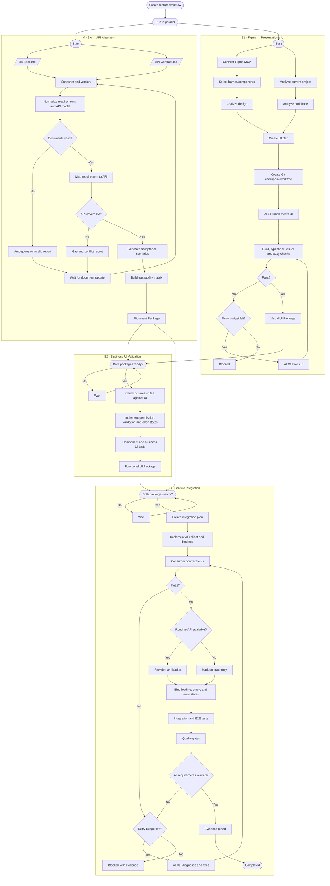
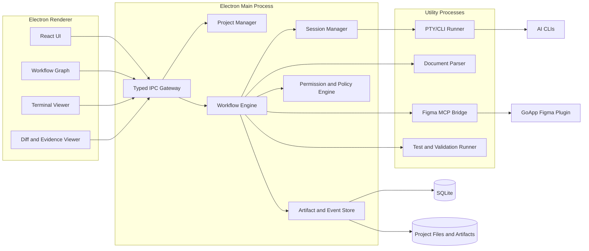

# GoApp FrontFlow

> Desktop control plane for AI-assisted frontend delivery

| Thuộc tính | Giá trị |
|---|---|
| Project name | **GoApp FrontFlow** |
| Repository slug | `goapp-frontflow` |
| Tài liệu | Product & Technical Implementation Specification |
| Phiên bản | 0.1 |
| Trạng thái | Draft for implementation |
| Cập nhật | 2026-10-22 |

## 1. Tóm tắt sản phẩm

GoApp FrontFlow là desktop application gắn với một source-code project trên máy người dùng và sử dụng các AI CLI như Codex CLI, Claude Code hoặc Gemini CLI làm execution engine.

Ứng dụng không thay thế AI CLI và không phải một workflow builder tổng quát như n8n. GoApp FrontFlow cung cấp:

- Workflow chuẩn hóa cho quá trình BA → API → Figma → frontend code → automated tests.
- Giao diện node graph kiểu n8n để theo dõi tiến độ.
- Quản lý và khôi phục nhiều AI CLI session theo project.
- Thu thập prompt, log, file diff, test result và evidence.
- Tự động điều phối bước tiếp theo dựa trên kết quả của bước trước.
- Truy vết từ business requirement tới API, Figma, source code và test.

### 1.1. Product statement

> GoApp FrontFlow biến quy trình triển khai frontend bằng AI CLI thành một pipeline có thể quan sát, tiếp tục, kiểm chứng và truy vết được.

### 1.2. Đối tượng sử dụng chính

- Frontend developer sử dụng AI để coding.
- Tech lead cần theo dõi chất lượng triển khai.
- BA/BE/QA cần xem gap report và implementation evidence.

## 2. Mục tiêu

### 2.1. Mục tiêu MVP

1. Mở hoặc attach một local frontend project.
2. Nhận diện stack, command và convention của project.
3. Upload BA Specification và API Contract dạng Markdown.
4. Phân tích conflict và mức độ đáp ứng giữa BA và API.
5. Kết nối GoApp Figma plugin qua MCP.
6. Triển khai giao diện từ frame/component được chọn.
7. Ghép API vào giao diện sau khi alignment đạt yêu cầu.
8. Sinh và chạy component, contract, integration và E2E tests.
9. Hiển thị workflow dưới dạng node graph có trạng thái thời gian thực.
10. Pause, resume, retry và lưu evidence của từng workflow run.

### 2.2. Ngoài phạm vi MVP

- Workflow builder kéo-thả tổng quát.
- Marketplace cho custom node.
- Cloud execution.
- Collaboration thời gian thực nhiều người.
- Tự động đăng nhập và chuyển đổi nhiều tài khoản AI CLI.
- Thay thế IDE hoặc Git client hoàn chỉnh.
- Tự động merge hoặc deploy production.

## 3. Nguyên tắc thiết kế

1. **AI CLI là execution engine:** app điều phối, không tái xây dựng coding agent.
2. **Evidence before completion:** không báo hoàn thành nếu chưa có bằng chứng kiểm chứng.
3. **Explicit uncertainty:** mọi suy luận phải được đánh dấu `assumed`, không được giả làm fact.
4. **Versioned inputs:** mỗi workflow run gắn với snapshot BA, API, Figma và Git commit cụ thể.
5. **Recoverable execution:** mọi thay đổi code phải có checkpoint và khả năng rollback.
6. **Structured events:** dashboard không phụ thuộc hoàn toàn vào việc parse text terminal.
7. **Project convention first:** code sinh ra phải sử dụng pattern và component của project hiện tại.
8. **Human control remains available:** người dùng có thể pause, cancel, retry hoặc can thiệp tại bất kỳ node nào.

## 4. Phạm vi workflow

GoApp FrontFlow sử dụng ba workflow nghiệp vụ chính.

### Workflow A — BA ↔ API Alignment

Phân tích BA Specification và API Contract, phát hiện thiếu sót/mâu thuẫn và sinh acceptance scenarios trước khi code.

### Workflow B — Figma → Functional UI

Triển khai presentational UI từ Figma, sau đó bổ sung validation, permission và business states từ Alignment Package.

### Workflow C — Feature Integration

Ghép API vào UI, thực thi contract/integration/E2E tests và tạo evidence report.

## 5. Workflow tổng thể



## 6. Definition of statuses

### 6.1. Workflow run status

```ts
type WorkflowRunStatus =
  | "queued"
  | "running"
  | "waiting"
  | "paused"
  | "completed"
  | "completed_with_assumptions"
  | "blocked"
  | "failed"
  | "cancelled"
  | "timed_out";
```

### 6.2. Node run status

```ts
type NodeRunStatus =
  | "pending"
  | "ready"
  | "running"
  | "waiting_for_dependency"
  | "waiting_for_input"
  | "retrying"
  | "passed"
  | "failed"
  | "blocked"
  | "skipped"
  | "cancelled";
```

### 6.3. Requirement alignment status

| Status | Ý nghĩa |
|---|---|
| `covered` | API đáp ứng rõ ràng yêu cầu BA |
| `partial` | Có API nhưng thiếu field/state/error case |
| `missing` | BA yêu cầu nhưng contract không có |
| `conflict` | BA và API mô tả trái ngược |
| `ambiguous` | Không đủ dữ liệu để kết luận |
| `not_required` | Có thể xử lý hoàn toàn tại FE |
| `assumed` | AI phải đưa ra giả định |

## 7. Kiến trúc hệ thống



## 8. Stack đề xuất

| Layer | Công nghệ đề xuất | Lý do |
|---|---|---|
| Desktop shell | Electron | Node.js integration phù hợp với filesystem, Git và AI CLI; hỗ trợ Windows/macOS/Linux |
| UI | React + TypeScript | Phù hợp năng lực FE và hệ sinh thái node graph |
| Workflow graph | React Flow | Chuyên cho node-based UI và interactive diagram |
| State UI | Zustand hoặc Redux Toolkit | Quản lý UI state; persistent business state vẫn ở database |
| Local database | SQLite | Một file local, transaction tốt, phù hợp desktop application |
| ORM/query | Drizzle ORM | Typed schema/migration; có thể thay bằng query layer khác |
| Terminal view | xterm.js | Render terminal output trong renderer |
| PTY | node-pty | Chạy CLI tương tác trên Windows/macOS/Linux |
| Git | Git CLI adapter | Tránh tái hiện đầy đủ Git implementation |
| Validation | Project-native commands | Tôn trọng toolchain hiện tại của project |
| Telemetry | OpenTelemetry-compatible event model | Correlate workflow, node, command và log |
| Unit test | Vitest | Test TypeScript domain/workflow engine |
| Desktop E2E | Playwright | Test Electron UI và workflow cơ bản |

Electron hỗ trợ tách workload sang `utilityProcess`; CLI runner, MCP bridge và parser không nên chạy trong renderer hoặc chặn main process. React Flow phù hợp với node-based interfaces. `node-pty` cung cấp PTY đa nền tảng nhưng process được chạy với quyền của app cha, vì vậy mọi execution phải đi qua policy engine.

### 8.1. Repository layout đề xuất

```text
goapp-frontflow/
├── apps/
│   └── desktop/
│       ├── src/main/
│       ├── src/preload/
│       └── src/renderer/
├── packages/
│   ├── domain/
│   ├── workflow-engine/
│   ├── project-analyzer/
│   ├── cli-adapters/
│   ├── figma-mcp-bridge/
│   ├── document-parser/
│   ├── event-schema/
│   ├── persistence/
│   └── ui-components/
├── workflows/
│   ├── ba-api-alignment.yaml
│   ├── figma-ui.yaml
│   └── feature-integration.yaml
├── tests/
│   ├── fixtures/
│   ├── integration/
│   └── e2e/
└── docs/
```

## 9. Electron security boundary

### 9.1. Renderer

- Không bật trực tiếp Node integration.
- Bật context isolation.
- Chỉ giao tiếp qua typed preload API.
- Không nhận raw filesystem path hoặc shell command không được kiểm tra.
- Sanitize Markdown trước khi render.

### 9.2. Main process

- Quản lý window, IPC, project permission và lifecycle.
- Không chạy tác vụ CPU-intensive hoặc PTY trực tiếp.
- Xác thực tất cả payload từ renderer.

### 9.3. Utility processes

- Một process riêng cho PTY/CLI execution.
- Một process riêng cho local MCP bridge khi cần.
- Có timeout, cancellation và crash recovery.
- Không chia sẻ secret qua command-line arguments.

## 10. Project onboarding

### 10.1. Luồng

```text
Choose project folder
  → Validate access
  → Detect Git repository
  → Analyze stack
  → Detect project commands
  → Detect installed AI CLIs
  → Create Project Profile
  → Restore prior sessions/runs
```

### 10.2. Project Profile

```yaml
schemaVersion: 1
projectId: ecommerce-web
rootPath: D:/projects/ecommerce-web
framework: nextjs
language: typescript
packageManager: pnpm
uiLibrary: antd
apiClient: tanstack-query
stateManagement: zustand
commands:
  install: pnpm install
  dev: pnpm dev
  build: pnpm build
  typecheck: pnpm typecheck
  lint: pnpm lint
  unitTest: pnpm test
  e2e: pnpm test:e2e
qualityGates:
  build: required
  typecheck: required
  lint: required
  unitTest: required
  contractTest: required
  e2e: required
  accessibility: WCAG-2.2-AA
git:
  executionMode: worktree
  defaultBaseBranch: main
```

### 10.3. Detection rules

- Đọc `package.json`, lockfile và framework config.
- Phát hiện `AGENTS.md`, `CLAUDE.md`, README và contribution guide.
- Tìm test config, route structure, API client và design tokens.
- Profile tự động phải được lưu kèm confidence và evidence.
- Người dùng có thể override mọi giá trị được phát hiện.

## 11. Input documents

### 11.1. BA Specification Markdown

Khuyến nghị template:

```markdown
# Feature: Cancel order

## Actors
- Customer
- Support agent

## Requirements

### BA-ORDER-001 — Customer cancels a pending order
- Actor: Customer
- Preconditions: Order status is PENDING
- Action: Confirm cancellation
- Result: Order status becomes CANCELLED
- Errors:
  - ORDER_NOT_FOUND
  - ORDER_CANNOT_BE_CANCELLED

## Acceptance criteria
- Given ... When ... Then ...
```

Parser vẫn phải hỗ trợ Markdown tự do, nhưng requirement có ID rõ ràng sẽ cho kết quả ổn định hơn.

### 11.2. API Contract Markdown

Khuyến nghị template:

```markdown
# Order API Contract

## POST /orders/{orderId}/cancel

- Operation ID: cancelOrder
- Authentication: Bearer token
- Allowed roles: CUSTOMER, SUPPORT

### Path parameters
- orderId: string, required

### Response 200
```json
{
  "id": "string",
  "status": "CANCELLED"
}
```

### Errors
- 404 ORDER_NOT_FOUND
- 409 ORDER_CANNOT_BE_CANCELLED
```

Ưu tiên cho phép nhúng hoặc tham chiếu OpenAPI JSON/YAML. Markdown được dùng cho giải thích nghiệp vụ, OpenAPI được dùng làm machine-readable contract.

### 11.3. Input snapshot

Mỗi workflow run phải lưu:

```ts
interface SourceSnapshot {
  id: string;
  type: "ba_markdown" | "api_markdown" | "openapi" | "figma";
  sourceUri?: string;
  contentHash: string;
  createdAt: string;
  metadata: Record<string, unknown>;
}
```

## 12. Workflow A — BA ↔ API Alignment

### 12.1. Node contracts

#### A1. SnapshotDocuments

**Input:** BA Markdown, API Markdown/OpenAPI.

**Output:** immutable `SourceSnapshot[]`.

**Failure conditions:** unreadable file, empty content, unsupported encoding.

#### A2. ExtractBusinessRequirements

**Output:**

```ts
interface BusinessRequirement {
  id: string;
  title: string;
  actor?: string;
  preconditions: string[];
  actions: string[];
  outcomes: string[];
  validations: string[];
  states: string[];
  errors: string[];
  sourceRefs: SourceReference[];
  confidence: number;
}
```

#### A3. ExtractApiOperations

**Output:**

```ts
interface ApiOperation {
  id: string;
  method: string;
  path: string;
  auth?: string;
  roles: string[];
  requestSchema?: JsonSchema;
  responses: ApiResponse[];
  sourceRefs: SourceReference[];
}
```

#### A4. VerifyDocuments

Kiểm tra requirement có:

- ID ổn định.
- Actor hoặc subject rõ ràng.
- Action và outcome.
- Không tự mâu thuẫn.
- Có thể kiểm chứng.

#### A5. MapRequirementsToApi

Tạo nhiều-nhiều mapping giữa `BusinessRequirement` và `ApiOperation`.

#### A6. ClassifyAlignment

Sinh `covered`, `partial`, `missing`, `conflict`, `ambiguous`, `not_required` hoặc `assumed`.

#### A7. GenerateAcceptanceScenarios

Acceptance scenarios phải được tạo trước implementation và không phụ thuộc code đã sinh.

#### A8. BuildTraceabilityMatrix

```ts
interface TraceabilityItem {
  requirementId: string;
  apiOperationIds: string[];
  figmaNodeIds: string[];
  sourceFiles: string[];
  testIds: string[];
  evidenceIds: string[];
  status: "unverified" | "verified" | "assumed" | "blocked";
}
```

### 12.2. Alignment Package

```ts
interface AlignmentPackage {
  version: 1;
  runId: string;
  sourceSnapshots: string[];
  requirements: BusinessRequirement[];
  operations: ApiOperation[];
  mappings: RequirementApiMapping[];
  scenarios: AcceptanceScenario[];
  traceability: TraceabilityItem[];
  summary: {
    covered: number;
    partial: number;
    missing: number;
    conflict: number;
    ambiguous: number;
  };
  readiness: "ready" | "ready_with_assumptions" | "not_ready";
}
```

### 12.3. Completion policy

- `ready`: không có `missing`, `conflict` hoặc `ambiguous` bắt buộc.
- `ready_with_assumptions`: chỉ còn assumption được policy cho phép.
- `not_ready`: còn blocker.

## 13. Workflow B1 — Figma → Presentational UI

### 13.1. Figma MCP architecture

```text
GoApp Figma Plugin
  ↕ WebSocket/HTTP with pairing token
GoApp FrontFlow Local Figma Bridge
  ↕ MCP tools/resources
AI CLI adapter
```

Desktop app sở hữu local bridge để:

- Theo dõi connection status.
- Bind Figma session với project/workflow.
- Log MCP calls.
- Cache và snapshot response.
- Giới hạn quyền theo selected file/page/node.
- Cho phép nhiều AI CLI dùng cùng integration mà plugin không cần biết từng CLI.

### 13.2. MCP tools tối thiểu

```text
get_connection_status
get_current_selection
get_node_summary
get_node_tree
get_component_properties
get_design_tokens
get_prototype_interactions
render_node
export_assets
get_warnings
```

Tool phải khai báo đặc tính như read-only, idempotent hoặc destructive, nhưng policy engine vẫn là nơi cưỡng chế quyền.

### 13.3. Context strategy

Không gửi toàn bộ Figma document vào prompt. Ban đầu chỉ cung cấp manifest:

```json
{
  "fileKey": "...",
  "pageId": "...",
  "selectedNodes": [
    {
      "nodeId": "123:456",
      "name": "Create Tournament Modal",
      "type": "FRAME",
      "states": ["default", "validation-error", "loading"]
    }
  ],
  "availableTools": [
    "get_node_tree",
    "get_design_tokens",
    "render_node",
    "export_assets"
  ]
}
```

AI gọi MCP theo nhu cầu để giảm context size.

### 13.4. Visual validation

- Render implementation tại viewport tương ứng.
- So sánh screenshot với Figma render.
- Kiểm tra layout, spacing, typography, color và assets.
- Kiểm tra responsive variants.
- Chạy accessibility checks theo project profile.
- Lưu screenshot/diff làm evidence.

## 14. Workflow B2 — Business UI Validation

Workflow này nhận `VisualUiPackage` và `AlignmentPackage`.

### 14.1. Trách nhiệm

- Kiểm tra mọi business state đã có UI representation.
- Áp dụng permission và visibility rules.
- Thêm client-side validation khi phù hợp.
- Xử lý loading, empty, recoverable error và fatal error.
- Sinh component/business UI tests từ acceptance scenarios.

### 14.2. Không được làm

- Không biến client-side validation thành nguồn authority cho security rule.
- Không tự tạo business rule trái API.
- Không đánh dấu `verified` cho assumption chưa có evidence.

## 15. Workflow C — Feature Integration

### 15.1. Các tầng kiểm chứng

| Level | Ý nghĩa |
|---|---|
| Document aligned | BA và API contract nhất quán |
| Consumer verified | FE API client gửi/nhận đúng contract |
| Provider verified | API runtime đáp ứng contract |
| Integration verified | UI xử lý đúng response và error states |
| E2E verified | User journey hoàn chỉnh hoạt động |

Nếu backend runtime không khả dụng, workflow chỉ được báo `contract-only`, không được báo `runtime verified`.

### 15.2. Quality gates

```yaml
gates:
  - id: build
    required: true
  - id: typecheck
    required: true
  - id: lint
    required: true
  - id: unit-test
    required: true
  - id: consumer-contract-test
    required: true
  - id: provider-verification
    required: false
    fallbackStatus: contract-only
  - id: integration-test
    required: true
  - id: e2e-test
    required: true
  - id: accessibility
    target: WCAG-2.2-AA
```

## 16. AI CLI adapter

### 16.1. Adapter interface

```ts
interface AiCliAdapter {
  readonly id: string;

  detect(): Promise<CliDetectionResult>;
  capabilities(): Promise<CliCapabilities>;
  start(input: StartSessionInput): Promise<AiSession>;
  resume(input: ResumeSessionInput): Promise<AiSession>;
  send(sessionId: string, message: string): Promise<void>;
  approve(sessionId: string, requestId: string): Promise<void>;
  reject(sessionId: string, requestId: string): Promise<void>;
  cancel(sessionId: string): Promise<void>;
  subscribe(sessionId: string, handler: AgentEventHandler): Unsubscribe;
}
```

### 16.2. Capability model

```ts
interface CliCapabilities {
  structuredEvents: boolean;
  resumableSessions: boolean;
  mcp: boolean;
  toolApprovals: boolean;
  modelSelection: boolean;
  usageReporting: boolean;
  imageInput: boolean;
}
```

App không giả định mọi CLI có cùng capability. Workflow node phải kiểm tra capability trước khi chạy.

### 16.3. Normalized agent events

```ts
type AgentEvent =
  | BaseEvent<"session.started", SessionStartedPayload>
  | BaseEvent<"status.changed", StatusChangedPayload>
  | BaseEvent<"message.delta", MessageDeltaPayload>
  | BaseEvent<"tool.started", ToolStartedPayload>
  | BaseEvent<"tool.completed", ToolCompletedPayload>
  | BaseEvent<"approval.required", ApprovalPayload>
  | BaseEvent<"file.changed", FileChangedPayload>
  | BaseEvent<"command.started", CommandStartedPayload>
  | BaseEvent<"command.completed", CommandCompletedPayload>
  | BaseEvent<"test.result", TestResultPayload>
  | BaseEvent<"usage.updated", UsagePayload>
  | BaseEvent<"session.completed", SessionCompletedPayload>
  | BaseEvent<"session.failed", SessionFailedPayload>;

interface BaseEvent<TType extends string, TPayload> {
  id: string;
  type: TType;
  timestamp: string;
  traceId: string;
  workflowRunId: string;
  nodeRunId?: string;
  sessionId?: string;
  payload: TPayload;
}
```

### 16.4. PTY fallback

Nếu CLI không cung cấp structured output:

1. Chạy trong PTY.
2. Lưu raw stream.
3. Adapter parse known markers thành normalized events.
4. Event không chắc chắn phải mang confidence.
5. Không dùng text parsing để tự động approve thao tác nguy hiểm.

## 17. Workflow engine

### 17.1. Node definition

```ts
interface WorkflowNodeDefinition<TInput, TOutput> {
  id: string;
  type: string;
  version: number;
  dependencies: string[];
  retryPolicy: RetryPolicy;
  timeoutMs: number;
  inputSchema: JsonSchema;
  outputSchema: JsonSchema;
  execute(context: NodeExecutionContext, input: TInput): Promise<TOutput>;
}
```

### 17.2. Retry policy

```ts
interface RetryPolicy {
  maxAttempts: number;
  backoff: "none" | "linear" | "exponential";
  retryableErrors: string[];
}
```

Không retry tự động các lỗi:

- Thiếu quyền truy cập.
- Tài liệu conflict.
- Command yêu cầu destructive approval.
- Test thất bại lặp lại cùng root cause quá retry budget.
- Project có thay đổi ngoài workflow làm invalid checkpoint.

### 17.3. Idempotency

- Mỗi node run có `idempotencyKey` dựa trên input hash và node version.
- Node read-only có thể dùng cached output.
- Node sửa code phải kiểm tra Git base SHA trước khi chạy lại.
- Không tái sử dụng output nếu BA/API/Figma snapshot đã đổi.

## 18. Persistence model

### 18.1. SQLite tables

```text
projects
project_profiles
source_documents
source_snapshots
workflow_definitions
workflow_runs
node_runs
ai_cli_installations
ai_sessions
agent_events
artifacts
requirements
api_operations
requirement_api_mappings
acceptance_scenarios
traceability_items
test_results
git_checkpoints
approvals
```

### 18.2. Artifact storage

SQLite lưu metadata; nội dung lớn lưu trên filesystem:

```text
{appData}/goapp-frontflow/
├── database.sqlite
├── projects/{projectId}/
│   ├── snapshots/
│   ├── runs/{runId}/
│   │   ├── documents/
│   │   ├── prompts/
│   │   ├── logs/
│   │   ├── diffs/
│   │   ├── screenshots/
│   │   ├── test-results/
│   │   └── evidence/
│   └── sessions/
└── logs/
```

Mỗi artifact cần `contentHash`, `mimeType`, `source`, `createdAt` và `retentionPolicy`.

## 19. Git execution safety

### 19.1. Preflight

- Ghi lại base commit SHA.
- Kiểm tra branch và working tree.
- Không ghi đè thay đổi có sẵn của người dùng.
- Khuyến nghị chạy workflow trong worktree hoặc branch riêng.
- Chụp diff trước và sau mỗi mutation node.

### 19.2. Concurrency

- Mặc định chỉ một mutation node được ghi vào cùng worktree tại một thời điểm.
- Read-only analysis nodes có thể chạy song song.
- Nếu cho phép nhiều agent code song song, mỗi agent dùng worktree riêng.
- Merge giữa worktree là một node explicit, không phải side effect ẩn.

### 19.3. Rollback

- Rollback về checkpoint của workflow, không reset toàn bộ project.
- Không dùng destructive Git operation trên working tree của người dùng.
- Hiển thị chính xác file sẽ bị ảnh hưởng trước khi rollback.

## 20. Dashboard UX

### 20.1. Main screens

1. **Projects:** danh sách project, stack, recent run và health.
2. **Project Overview:** profile, Git status, CLI integrations và workflows.
3. **New Feature Run:** upload BA/API, kết nối Figma, chọn scope.
4. **Workflow Canvas:** node graph và execution state.
5. **Node Inspector:** input, prompt, session, tools, output, diff và evidence.
6. **Requirement Matrix:** BA ↔ API ↔ Figma ↔ code ↔ tests.
7. **Sessions:** AI CLI sessions có thể resume.
8. **Settings:** CLI adapters, MCP, security, retention và quality gates.

### 20.2. Workflow node visual states

| State | Biểu diễn |
|---|---|
| Pending | Neutral |
| Running | Animated activity indicator |
| Passed | Success indicator |
| Waiting | Waiting indicator và dependency label |
| Retrying | Attempt counter |
| Blocked | Warning indicator và blocker summary |
| Failed | Error indicator |
| Assumed | Assumption badge |

Không chỉ dùng màu; luôn có icon và text để đảm bảo accessibility.

### 20.3. Node Inspector tabs

- Overview.
- Inputs.
- AI session.
- Terminal.
- Files changed.
- Tests.
- Evidence.
- Events.

## 21. Observability

Mỗi workflow run là một trace:

```text
workflow.run
├── node.analyze_ba
├── node.analyze_api
├── node.map_requirements
├── node.implement_ui
│   ├── ai.session
│   ├── tool.call
│   ├── file.write
│   └── command.test
└── node.verify
```

### 21.1. Metrics MVP

- Workflow duration.
- Node duration.
- Retry count.
- Pass/fail/blocked rate.
- AI token/cost nếu CLI cung cấp.
- Files changed.
- Test pass rate.
- Requirement coverage.
- Time waiting for external input.

### 21.2. Logging rules

- Structured JSON events.
- Redact tokens, secrets và environment variables.
- Không lưu toàn bộ request/response nhạy cảm mặc định.
- Raw PTY log có retention riêng và có thể tắt.

## 22. Security model

### 22.1. Trust boundaries

- Uploaded Markdown là untrusted input.
- Figma content là untrusted input.
- Repository files có thể chứa prompt injection.
- AI-generated command là untrusted action proposal.
- MCP tool annotations chỉ là metadata; host policy mới quyết định quyền.

### 22.2. Permission classes

```ts
type PermissionClass =
  | "read_project"
  | "write_project"
  | "run_project_command"
  | "git_mutation"
  | "network_access"
  | "read_external_design"
  | "export_asset"
  | "destructive_action";
```

### 22.3. Default policy

- Read project: allow after project selection.
- Write project: allow only inside active worktree/root.
- Run known scripts: allow according to project profile.
- Arbitrary shell command: log and evaluate policy.
- Destructive action: always require explicit approval in MVP.
- External network: deny unless integration requires it.
- Credentials: store bằng OS credential vault, không lưu plaintext trong SQLite.

### 22.4. Figma MCP pairing

- Bind local connection to one-time pairing token.
- Token có expiry và scope theo project/workflow.
- Chỉ bind localhost mặc định.
- Plugin hiển thị app/session đang kết nối.
- Người dùng có thể revoke connection.

## 23. Testing strategy cho GoApp FrontFlow

### 23.1. Unit tests

- Workflow state transitions.
- Retry/timeout/cancellation.
- Requirement/API classification.
- Event normalization.
- Permission policy.
- Hash/version invalidation.

### 23.2. Adapter contract tests

Mọi AI CLI adapter phải chạy cùng một contract suite:

- Detect installation.
- Start session.
- Send prompt.
- Receive normalized events.
- Handle approval.
- Cancel.
- Resume nếu supported.
- Recover process exit.

### 23.3. Integration tests

- SQLite migrations and persistence.
- PTY runner với fake CLI fixture.
- Figma MCP bridge với fake plugin.
- Git worktree/checkpoint lifecycle.
- Document upload → Alignment Package.

### 23.4. Desktop E2E

- Open project.
- Create workflow run.
- Upload Markdown.
- Connect fake Figma plugin.
- Run fake AI CLI.
- Inspect node output.
- Pause/resume/retry.
- Restart app và restore session/run.

## 24. Implementation roadmap

### Phase 0 — Technical spike

**Mục tiêu:** chứng minh các integration rủi ro cao.

- Electron main/renderer/utility-process skeleton.
- Chạy một fake CLI và một real AI CLI qua PTY.
- Stream output tới renderer.
- Persist/reload một session.
- Hiển thị static workflow bằng React Flow.
- Local Figma MCP bridge proof of concept.

**Exit criteria:** app có thể chạy/resume một CLI session và nhận một MCP tool result.

### Phase 1 — Project workspace

- Project picker.
- Project analyzer.
- Project Profile.
- Git preflight/checkpoint.
- SQLite schema/migrations.
- Projects dashboard.

**Exit criteria:** mở lại app vẫn khôi phục project/profile chính xác.

### Phase 2 — Workflow runtime

- Workflow/node definitions.
- Scheduler và dependency resolution.
- State machine.
- Retry, timeout, pause, resume, cancel.
- Artifact store và event stream.
- Workflow Canvas và Node Inspector.

**Exit criteria:** chạy hoàn chỉnh một sample DAG có parallel, branch, retry và restart recovery.

### Phase 3 — BA/API Alignment

- Markdown upload/snapshot.
- BA/API parsers.
- Normalized models.
- Mapping/classification.
- Acceptance scenarios.
- Traceability Matrix UI.
- Gap & Conflict Report.

**Exit criteria:** fixture set tạo kết quả deterministic và có source references.

### Phase 4 — Figma presentational UI

- Production-ready local bridge.
- Pairing và connection status.
- Selection manifest.
- MCP tools.
- Figma snapshot/artifacts.
- AI CLI implementation node.
- Visual validation evidence.

**Exit criteria:** từ selected frame có thể tạo UI trong sample project và lưu screenshot/diff.

### Phase 5 — Business UI and integration

- Business UI validation.
- API client integration.
- Consumer contract tests.
- Provider availability handling.
- Integration/E2E execution.
- Retry/root-cause loop.

**Exit criteria:** hoàn thành một feature sample từ BA/API/Figma tới E2E evidence.

### Phase 6 — Hardening

- Permission policy.
- Secret redaction.
- Crash recovery.
- Large log handling.
- Accessibility.
- Performance.
- Packaging, signing và auto-update strategy.

## 25. MVP backlog ưu tiên

### P0

- Electron application shell.
- Project picker và Project Profile.
- SQLite persistence.
- One AI CLI adapter.
- PTY terminal stream.
- Workflow engine.
- Workflow Canvas.
- Markdown upload/snapshot.
- BA/API alignment.
- GoApp Figma MCP bridge.
- Git checkpoint/worktree safety.
- Test command runner.
- Evidence report.

### P1

- Thêm AI CLI adapters.
- Visual regression automation.
- Consumer contract testing adapters.
- OpenTelemetry exporter.
- Workflow templates theo framework.
- Cost/token analytics.

### P2

- Multiple AI accounts.
- Cloud sync.
- Team collaboration.
- Plugin SDK.
- Custom workflow authoring.

## 26. Definition of Done cho MVP

MVP được coi là hoàn thành khi:

1. Người dùng mở một project frontend local.
2. App phát hiện stack và validation commands.
3. Người dùng upload BA/API Markdown.
4. Workflow A tạo Alignment Package và Gap Report có source references.
5. Người dùng kết nối GoApp Figma plugin và chọn frame.
6. Một AI CLI triển khai presentational UI trong worktree an toàn.
7. Workflow B bổ sung business states từ Alignment Package.
8. Workflow C ghép API và chạy test.
9. Dashboard hiển thị trạng thái từng node và có thể resume sau khi restart.
10. Mỗi requirement liên kết được với API, code, tests và evidence.
11. Retry không chạy vô hạn và kết thúc bằng trạng thái rõ ràng.
12. Secret không xuất hiện trong UI log hoặc artifact mặc định.

## 27. Những quyết định còn mở

Các quyết định này không chặn Phase 0 nhưng phải chốt trước phase tương ứng:

1. AI CLI đầu tiên được hỗ trợ chính thức.
2. Dùng worktree mặc định hay branch trong current checkout.
3. Cách plugin Figma hiện tại kết nối với local bridge.
4. Contract testing library theo stack project.
5. Cơ chế visual diff và ngưỡng sai lệch.
6. Retention mặc định cho raw terminal log và screenshots.
7. Chính sách cho `ready_with_assumptions`.
8. Có cho phép app tự chạy arbitrary shell command trong MVP hay không.

## 28. Tiêu chuẩn và tài liệu tham chiếu

- ISO/IEC/IEEE 29148:2018 — requirements engineering và traceability.
- OpenAPI Specification — machine-readable HTTP API contracts.
- JSON Schema 2020-12 — schema validation.
- WCAG 2.2 / ISO/IEC 40500:2025 — accessibility target.
- OWASP ASVS 5.0 — application security verification requirements.
- Model Context Protocol specification — MCP tools/resources/auth model.
- OpenTelemetry — traces, metrics và structured logs.
- Pact documentation — consumer/provider contract testing concepts.
- Electron process model — main, renderer và utility process isolation.
- React Flow — node-based workflow visualization.
- SQLite — embedded local application storage.

## 29. Tài liệu kỹ thuật chính thức

- [Electron Process Model](https://www.electronjs.org/docs/latest/tutorial/process-model)
- [React Flow](https://reactflow.dev/)
- [node-pty](https://github.com/microsoft/node-pty)
- [SQLite as an application file format](https://www.sqlite.org/appfileformat.html)
- [OpenAPI Specification](https://spec.openapis.org/oas/)
- [JSON Schema 2020-12](https://json-schema.org/draft/2020-12)
- [WCAG 2.2](https://www.w3.org/TR/WCAG22/)
- [OWASP ASVS](https://asvs.owasp.org/)
- [OpenTelemetry Signals](https://opentelemetry.io/docs/concepts/signals/)
- [Pact Contract Testing](https://docs.pact.io/)

---

**Tên đề xuất chính thức:** GoApp FrontFlow  
**Tagline:** From spec and design to verified frontend.
